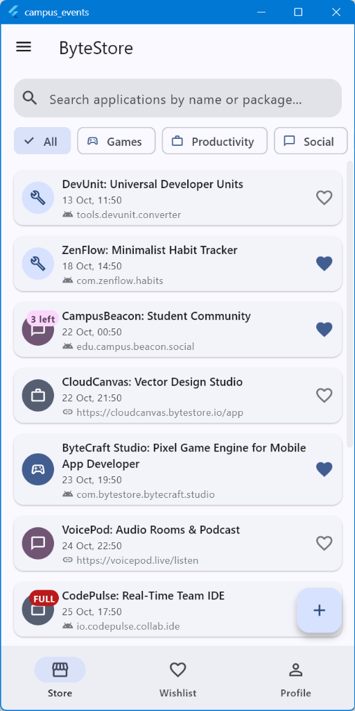
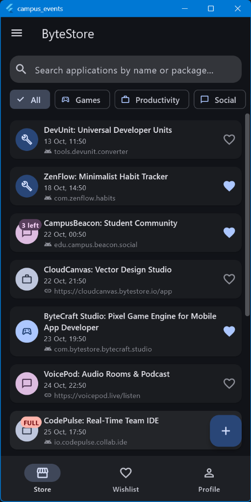
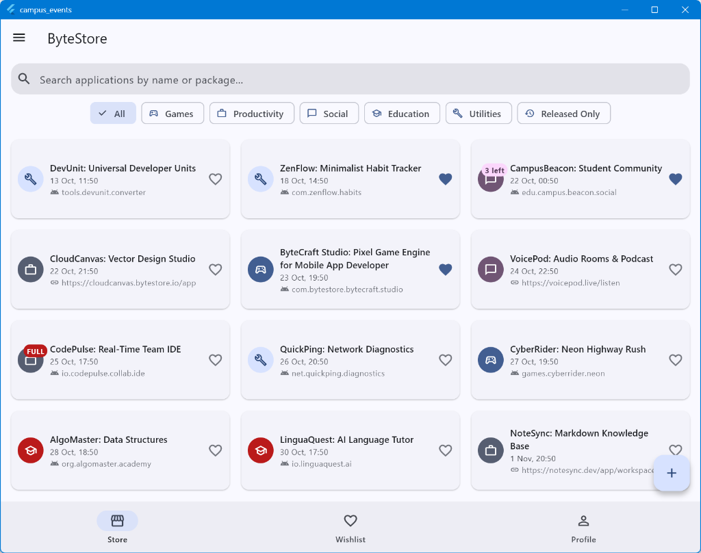

# ByteStore — Fake App Store & Beta Hub

A multi-screen Flutter application representing a developer app store and beta testing hub built with pure in-memory state management.

## Domain

**ByteStore** is an application distribution and beta access hub where developers can publish apps, set tester capacity limits, and manage release schedules. Users can browse categories, join beta testing programs, bookmark applications to their wishlist, and manage their tester profile.

## Screenshots

| Phone (Light Theme) | Phone (Dark Theme) | Tablet (Grid Layout) |
| :---: | :---: | :---: |
|  |  |  |

## Decisions

The item list and profile state live in the shell's `State` so that all child tabs and sub-screens can receive them via constructor parameters and trigger state updates consistently. The detail screen receives callbacks to perform atomic in-place updates (such as joining beta or deleting an app) without needing global state management, whereas the form returns an `Item` through `Navigator.pop` to treat creation and editing as discrete modal transactions that can be cleanly committed or discarded. The responsive layout uses `LayoutBuilder` rather than `MediaQuery` because layout decisions should depend strictly on the parent container's local constraints rather than the entire device window. The `PopScope` compares the form's current controller and field values against the initial values captured when the screen opened, ensuring that users are only prompted to discard if changes were actually made. With week 9's architecture and tools, we would introduce a dedicated state management solution along with persistent local storage to decouple UI components from state synchronization and eliminate prop drilling through constructor callbacks.
